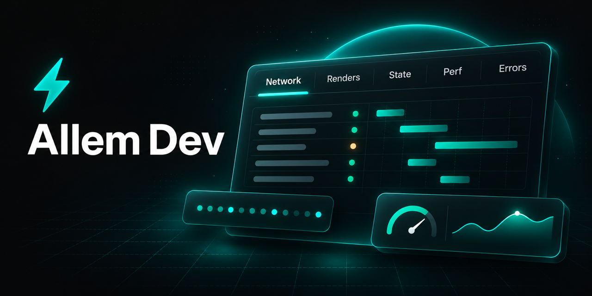

<p align="center">
  
</p>

<p align="center">
  <a href="https://www.npmjs.com/package/allem-dev"></a>
  <a href="./LICENSE"></a>
  
  
</p>

The floating dev panel for React. API inspector, re-render tracker, state timeline, performance profiler, and error catcher — all in one import.

## Quick Start

```bash
npm install allem-dev
```

```tsx
import { AllemDev } from "allem-dev";

function App() {
  return (
    <>
      <YourApp />
      <AllemDev />
    </>
  );
}
```

**Toggle with `Ctrl+Shift+D`** (or `Cmd+Shift+D` on Mac). That's it.

## What You Get

| Tab | What It Does |
|-----|-------------|
| **Network** | Intercepts all `fetch()` and `XMLHttpRequest` calls. Shows method, URL, status, timing, headers, request/response bodies. |
| **Renders** | Tracks every React component re-render. Shows which components re-rendered, why, how long it took, and which props/state changed. |
| **State** | Timeline of all state changes across `useState`, Zustand, Redux, and Jotai. Shows previous → next values with diffs. |
| **Perf** | Core Web Vitals (LCP, FID, CLS, INP, TTFB), live FPS counter, and JS heap memory usage. Color-coded ratings. |
| **Errors** | Catches runtime errors, unhandled promise rejections, and `console.error` calls. Parses stack traces with source file links. |

## Packages

| Package | Description |
|---------|-------------|
| `allem-dev` | The `<AllemDev />` React component — one import to get everything |
| `@allem-dev/core` | Panel shell, keyboard shortcuts, event bus, types |
| `@allem-dev/network` | Fetch/XHR interceptor and request store |
| `@allem-dev/renders` | Re-render tracker and profiler callbacks |
| `@allem-dev/state` | State change timeline and value differ |
| `@allem-dev/perf` | Web Vitals, FPS counter, memory tracker |
| `@allem-dev/errors` | Error catcher, console interceptor, stack parser |

## Configuration

```tsx
<AllemDev
  config={{
    shortcut: "ctrl+shift+d",   // keyboard shortcut
    position: "bottom",          // "bottom" | "right" | "floating"
    height: 350,                 // panel height in pixels
    theme: "dark",               // "dark" | "light" | "auto"
    maxEntries: 500,             // max log entries per store
    enableInProduction: false,   // auto-disabled in production
  }}
/>
```

## Zero Overhead in Production

Allem Dev automatically disables itself when `NODE_ENV === "production"`. No interceptors, no DOM, no bundle impact. To force-enable, set `enableInProduction: true`.

## Tech Stack

- [React](https://react.dev/) 18+ (hooks, `useSyncExternalStore`)
- [TypeScript](https://www.typescriptlang.org/) (strict mode)
- [Turborepo](https://turbo.build/) + [pnpm](https://pnpm.io/) workspaces
- Zero runtime dependencies (only React peer dep)

## Development

```bash
git clone https://github.com/kingofmit/allem-dev.git
cd allem-dev
pnpm install
pnpm build
```

See [CONTRIBUTING.md](./CONTRIBUTING.md) for more details.

## Support

If you find Allem Dev useful, consider supporting its development:

<a href="https://buymeacoffee.com/kingofmit" target="_blank"></a>

## License

[MIT](./LICENSE) - [Ahmed Allem](https://kingallem.com)
